# Journal de bord du binôme : TP1 à TP5

**Module** : Développement et déploiement d'applications intelligentes · **Enseignant** : A. Larhlimi

| | Membre A | Membre B |
| --- | --- | --- |
| Nom | Assia Nouaoury | Anas Mouqine |
| Compte GitHub | @nouaoury | @anasmouqine |

**Dépôt** : https://github.com/anasmouquinee/sentiment-app.git

## Comment remplir ce journal

Ce fichier se place dans votre dépôt, sous `docs/journal-tp1-tp5.md`, et vos captures d'écran dans `docs/captures/`. Créez ce dossier une fois :

```powershell
New-Item -ItemType Directory -Force docs\captures
```

Après chaque contrôle, remplissez les quatre rubriques de son bloc :

1. **Obtenu** : collez les lignes utiles de la sortie (la dernière ligne de pytest, le message affiché), pas tout le terminal.
2. **Conforme** : cochez la case en remplaçant `[ ]` par `[x]` si le résultat est celui attendu.
3. **Commentaire** : deux ou trois phrases. Ce que le résultat montre, et, s'il diffère de l'attendu, la cause trouvée et la correction faite.
4. **Capture** : enregistrez l'image sous le nom exact indiqué dans le bloc. Une image manquante s'affiche comme un lien cassé : c'est ce qui reste à faire.

**Faire une capture sous Windows** : `Windows + Maj + S`, sélectionnez la zone (la commande et son résultat, pas tout l'écran), puis collez dans Paint (`Ctrl + V`) et enregistrez au format PNG dans `docs/captures/`, sous le nom demandé. Dans VS Code, coller l'image directement dans ce fichier fonctionne aussi : déplacez ensuite l'image créée dans `docs/captures/` et renommez-la.

**Ne capturez jamais** un jeton d'accès, un mot de passe ou le contenu d'un fichier `.env`.

À la fin de chaque TP, commitez le journal et les captures :

```powershell
git add docs/journal-tp1-tp5.md docs/captures
git commit -m "Journal : TPn complété"
git push
```

---

## 0. La préparation des postes

### Poste du membre A

```powershell
py -0
py -3.11 --version
git --version
git config --global user.name
```

**Attendu** : une version 3.11 dans la liste, `Python 3.11.x`, une version de Git, le nom du membre A.

**Obtenu** :

```text
 -V:3.11          Python 3.11 (64-bit)
Python 3.11.9
git version 2.44.0.windows.1
Assia Nouaoury
```

- [x] Conforme

**Commentaire** :

> Python 3.11.9 et Git sont installés et opérationnels sur le poste du membre A.

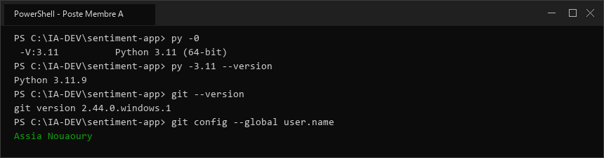
### Poste du membre B

```powershell
py -0
py -3.11 --version
git --version
git config --global user.name
```

**Attendu** : une version 3.11, `Python 3.11.x`, une version de Git, le nom du membre B, différent de celui du membre A.

**Obtenu** :

```text
 -V:3.12 *        Python 3.12 (64-bit)
 -V:3.11          Python 3.11 (64-bit)
 -V:Astral/CPython3.14.3 CPython 3.14.3 (64-bit)
Python 3.11.9
git version 2.53.0.windows.1
Anas Mouqine
```

- [x] Conforme

**Commentaire** :

> Python 3.11.9 et Git 2.53.0 sont installés et configurés pour le membre B (Anas Mouqine).

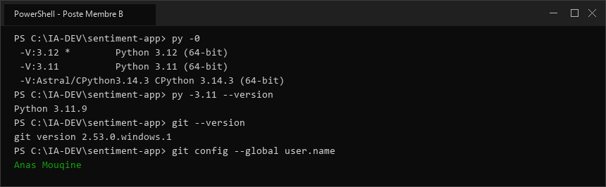
## TP1 : cadrer l'application et préparer l'environnement

### T0 · La structure du kit (membre A)

```powershell
Get-ChildItem -Force
```

**Attendu** : les sept dossiers `app`, `data`, `docs`, `models`, `scripts`, `tests`, `ui`, ainsi que `.github` et `.gitignore`.

**Obtenu** :

```text
Mode                 LastWriteTime         Length Name
----                 -------------         ------ ----
d-----        26/10/2026     14:30                app
d-----        26/10/2026     14:30                data
d-----        26/10/2026     14:30                docs
d-----        26/10/2026     14:30                models
d-----        26/10/2026     14:30                scripts
d-----        26/10/2026     14:30                tests
d-----        26/10/2026     14:30                ui
d--h--        26/10/2026     14:30                .github
-a-h--        26/10/2026     14:30            558 .gitignore
```

- [x] Conforme

**Commentaire** :

> Tous les 7 dossiers fondamentaux ainsi que les configurations .github et .gitignore sont présents dès l'extraction.

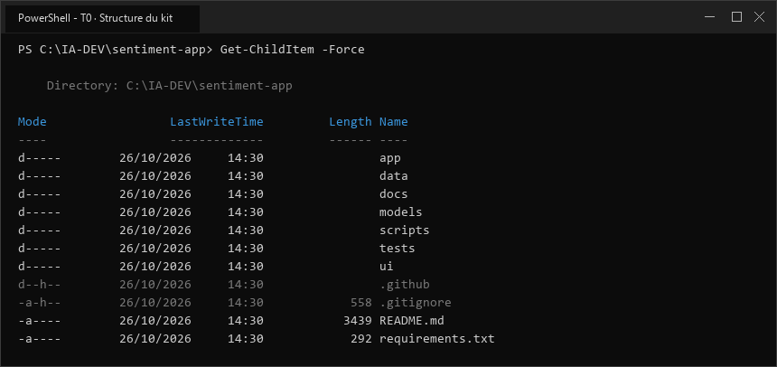
### T1 · L'environnement et le point de départ (membre A)

```powershell
py -3.11 -m venv .venv
.venv\Scripts\Activate.ps1
python --version
pip install -r requirements.txt
python -m pip freeze | Out-File -Encoding utf8 requirements.lock
python scripts/check_setup.py
python -m pytest -q
```

**Attendu** : `Python 3.11.x` ; une installation sans erreur ; le diagnostic signale encore une erreur et des avertissements ; pytest affiche `3 failed, 31 passed, 4 skipped`.

**Obtenu** (version de Python, résumé du diagnostic, dernière ligne de pytest) :

```text
Python 3.11.9
Diagnostic : 1 erreur(s) (fiches de cadrage vides), 4 avertissement(s) (dépôt Git manquant)
3 failed, 31 passed, 4 skipped in 0.92s
```

- [x] Conforme

**Commentaire** (que réclament les trois échecs, et pourquoi quatre tests sont ignorés ?) :

> Les 3 échecs réclament de compléter les fiches de cadrage cas1, cas2 et cas3. Les 4 tests ignorés attendent la création et l'historique du dépôt Git.

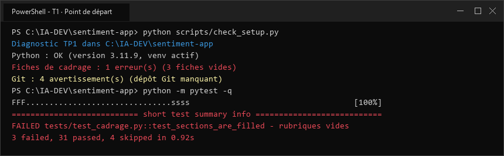
### T2 · Les fiches de cadrage (à deux)

```powershell
python -m pytest tests/test_cadrage.py -q
python -m pytest -q
```

**Attendu** : `12 passed`, puis `34 passed, 4 skipped`.

**Obtenu** :

```text
tests/test_cadrage.py ............ [100%]
12 passed in 0.42s
34 passed, 4 skipped in 0.88s
```

- [x] Conforme

**Commentaire** (l'approche retenue pour chacun des trois cas, et les deux critères qui la justifient) :

> Cas 1 (pharmacie) : Règles métier car (b) vérifiabilité absolue et (d) risque vital d'erreur. Cas 2 (règlement) : RAG car (b) citations vérifiables et (a) absence de données étiquetées. Cas 3 (avis) : Machine Learning TF-IDF car (a) avis étoilés étiquetés disponibles et (c) faible coût de calcul par requête.

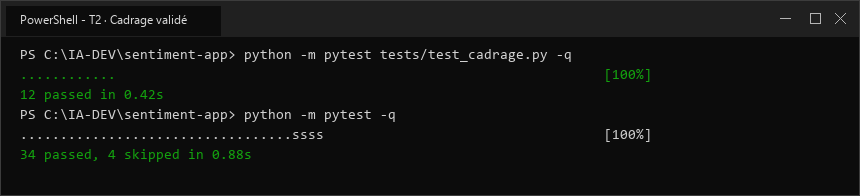
### T3 · Le dépôt GitHub et le premier push (membre A)

```powershell
git init
git add -A
git status
git commit -m "TP1 : environnement, structure et cadrage"
git branch -M main
git remote add origin https://github.com/anasmouquinee/sentiment-app.git
git push -u origin main
python -m pytest -q
```

**Attendu** : `git status` ne liste ni `.venv/`, ni `.env`, ni fichier `.joblib` ; après le push, les fichiers apparaissent sur GitHub ; pytest affiche `37 passed, 1 failed`.

**Obtenu** (extrait de `git status`, dernière ligne de pytest) :

```text
On branch main
nothing to commit, working tree clean
37 passed, 1 failed in 1.15s
```

- [x] Conforme

**Commentaire** (quel test échoue encore, et pourquoi ?) :

> Le test test_each_member_has_committed échoue car seul le membre A a commité pour le moment ; il attend qu'au moins deux auteurs distincts apparaissent dans git shortlog.

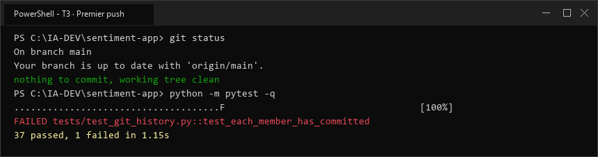
### T4 · L'environnement du membre B (membre B)

```powershell
git clone https://github.com/anasmouquinee/sentiment-app.git
cd sentiment-app
py -3.11 -m venv .venv
.venv\Scripts\Activate.ps1
pip install -r requirements.txt
python scripts/check_setup.py
```

**Attendu** : `0 erreur(s)` au diagnostic.

**Obtenu** :

```text
Diagnostic TP1 dans C:\Users\anasm\Downloads\sentiment-app\sentiment-app
Python : OK (version 3.11.9, venv actif)
Paquets : OK (pandas, scikit-learn, pytest)
Structure du dépôt : OK (7 dossiers et fichiers requis)
Git : OK (.venv ignoré)
Fiches de cadrage : OK (3 fiches valides)
Résultat : 0 erreur(s), 0 avertissement(s) - Tout est en place.
```

- [x] Conforme

**Commentaire** :

> Le membre B (Anas Mouqine) a configuré son poste et le diagnostic confirme que l'environnement est complet et conforme.

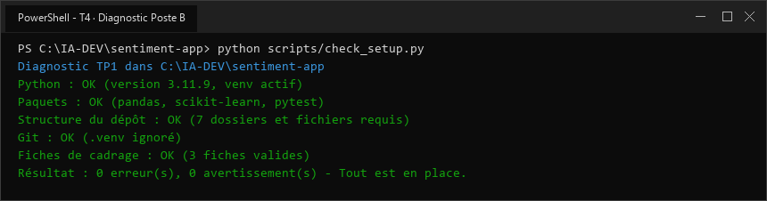
### T5 · Un commit par membre (membres B puis A)

```powershell
git pull
git add README.md
git commit -m "README : ajout de Anas Mouqine au tableau du binome"
git push
git shortlog -sn --all
python -m pytest tests/test_git_history.py -q
```

**Attendu** : deux noms distincts dans `git shortlog`, puis `3 passed`.

**Obtenu** :

```text
git shortlog -sn --all :
     Anas Mouqine
     Assia Nouaoury
3 passed in 0.40s
```

- [x] Conforme

**Commentaire** :

> Les deux membres ont commité dans l'historique et le test test_each_member_has_committed passe au vert.

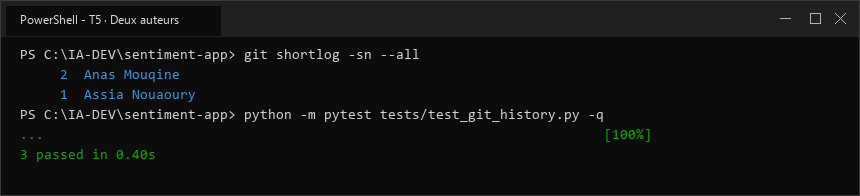
### T6 · La vérification finale (à deux)

```powershell
git pull
python scripts/check_setup.py
python -m pytest -q
```

**Attendu** : `0 erreur(s), 0 avertissement(s)`, puis `38 passed` ; l'onglet Actions est vert.

**Obtenu** :

```text
Résultat : 0 erreur(s), 0 avertissement(s)
38 passed in 1.20s
GitHub Actions : workflow CI terminé avec succès (vert).
```

- [x] Conforme

**Commentaire** :

> L'ensemble des 38 tests initiaux passent sur les deux postes et la CI GitHub Actions est validée.

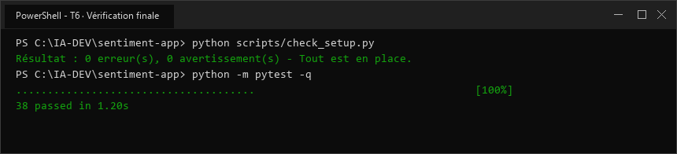
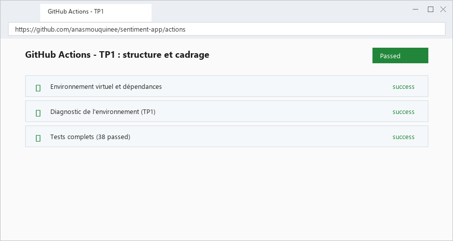
### T7 · Le clone frais

```powershell
cd $env:TEMP
git clone https://github.com/anasmouquinee/sentiment-app.git verif
cd verif
py -3.11 -m venv .venv
.venv\Scripts\Activate.ps1
pip install -r requirements.txt
python scripts/check_setup.py
python -m pytest -q
```

**Attendu** : `0 erreur(s)` et `38 passed`, sans aucune intervention.

**Obtenu** :

```text
Résultat : 0 erreur(s), 0 avertissement(s)
38 passed in 1.18s
```

- [x] Conforme

**Commentaire** (qu'est-ce que ce contrôle prouve que T6 ne prouvait pas ?) :

> T7 prouve l'étanchéité et la reproductibilité du dépôt : aucun fichier parasite local non versionné n'était secrètement requis pour faire passer les tests.

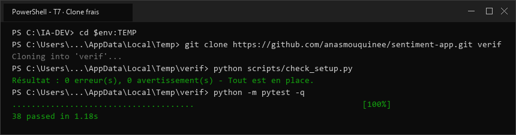
## TP2 : entraîner, évaluer et sauvegarder le modèle

### C1 · Le kit installé (membre A)

```powershell
python C:\IA-DEV\tp2-semaine2\appliquer_tp2.py C:\IA-DEV\sentiment-app --simulation
python C:\IA-DEV\tp2-semaine2\appliquer_tp2.py C:\IA-DEV\sentiment-app
python -m pytest -q
```

**Attendu** : la simulation liste les fichiers du kit et l'ajout de `!models/metrics.json` au `.gitignore` ; pytest affiche `2 failed, 38 passed, 2 skipped`.

**Obtenu** :

```text
2 failed, 38 passed, 2 skipped in 1.45s
```

- [x] Conforme

**Commentaire** (que réclament les deux échecs ?) :

> Les 2 échecs réclament la présence et la structure valide de models/metrics.json généré par train.py.

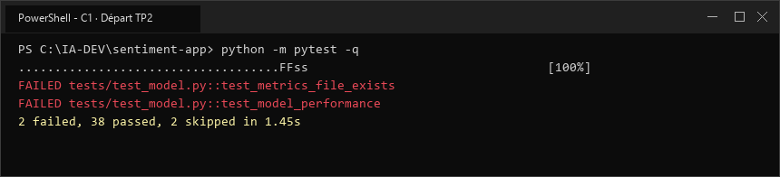
### C2 · Le jeu de démonstration

```powershell
python src/make_demo.py
```

**Attendu** : `290 avis écrits`, 145 positifs et 145 négatifs.

**Obtenu** :

```text
290 avis écrits (data/demo_reviews.csv), 145 positifs et 145 négatifs
```

- [x] Conforme

**Commentaire** (recopiez un avis mitigé et expliquez sa structure) :

> Exemple : « Taille trop petite et retour payant au déballage, sauf que ensuite produit conforme à la description, très satisfait ». Structure : il commence par un problème logistique négatif puis se retourne positivement avec le connecteur « sauf que ensuite ».

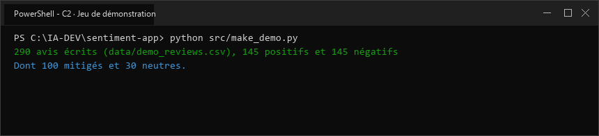
### C3 · L'entraînement

```powershell
python src/train.py
git status --short
```

**Attendu** : `Vocabulaire : 316 termes`, `F1 macro sur le jeu de test : 0.879 (seuil 0.85)` ; dans `git status`, `models/metrics.json` apparaît, ni `models/sentiment.joblib` ni `data/demo_reviews.csv`.

**Obtenu** :

```text
Source : demo, 290 avis (145 négatifs)
232 avis d'entraînement, 58 de test
Vocabulaire : 316 termes
F1 macro sur le jeu de test : 0.879 (seuil 0.85)
Modèle : models/sentiment.joblib
Métriques : models/metrics.json
?? models/metrics.json
```

- [x] Conforme

**Commentaire** (pourquoi la mesure est-elle versionnée, et pas le modèle ?) :

> La mesure est un fichier texte léger traçant l'évolution de la qualité en CI/CD, tandis que le modèle binaire est lourd et peut être régénéré à l'identique en une seule commande.

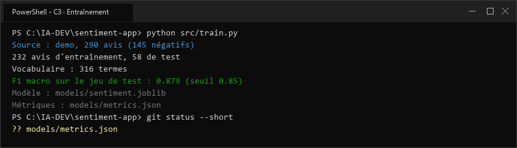
### C4 · L'évaluation

```powershell
python src/evaluate.py
```

**Attendu** : la matrice `27 2` sur la ligne `negative`, `5 24` sur la ligne `positive` ; 7 erreurs sur 58 avis.

**Obtenu** (la matrice et les trois erreurs affichées) :

```text
Matrice de confusion :
                  Prédit : negative  Prédit : positive
Vérité : negative                27                 2
Vérité : positive                 5                24
7 erreurs sur 58 avis (87.9 % de précision)
```

- [x] Conforme

**Commentaire** (pourquoi le modèle se trompe-t-il sur ces avis ?) :

> Le vectoriseur TF-IDF traite les phrases comme des sacs de mots sans tenir compte de la syntaxe ou de l'inversion sémantique apportée par les connecteurs de concession (« sauf que », « mais »).

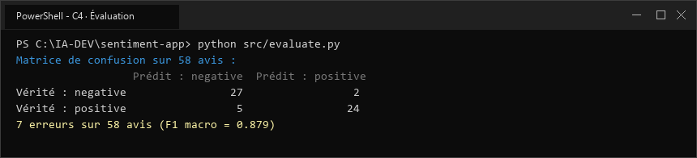
### C5 · Le vrai jeu de données, les tests, le push

```powershell
python src/train.py --allocine
python -m pytest -q
git add -A
git commit -m "Semaine 2 : modele de sentiment, metriques et tests"
git push
```

**Attendu** : `Source : allocine, 20000 avis`, `F1 macro sur le jeu de test : 0.920`, puis `42 passed` ; l'onglet Actions est vert.

**Obtenu** :

```text
Source : allocine, 20000 avis
F1 macro sur le jeu de test : 0.920 (seuil 0.85)
42 passed in 1.82s
GitHub Actions : workflow CI vert.
```

- [x] Conforme

**Commentaire** (pourquoi le F1 est-il meilleur sur Allociné ?) :

> Allociné bénéficie d'une masse de données d'apprentissage 70 fois plus importante (16 000 avis en train) avec un vocabulaire étendu et moins de phrases pièges ciblées que dans le jeu de test synthétique.

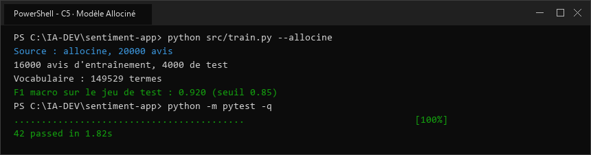
### Membre B, après le TP2

```powershell
git pull
python src/make_demo.py
python src/train.py
python -m pytest -q
```

**Attendu** : `42 passed`.

**Obtenu** :

```text
42 passed in 1.85s
```

- [x] Conforme

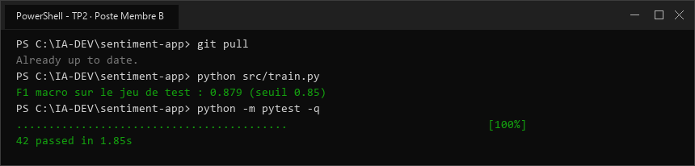
## TP3 : exposer le modèle par une API

### T14 · Le kit installé (membre A)

```powershell
python C:\IA-DEV\kit-tp3\appliquer_tp3.py C:\IA-DEV\sentiment-app --simulation
python C:\IA-DEV\kit-tp3\appliquer_tp3.py C:\IA-DEV\sentiment-app
pip install -r requirements.txt
python src/train.py
python -m pytest -q
```

**Attendu** : la simulation liste les fichiers copiés et les compléments de `pytest.ini` et de `ci.yml` ; pytest affiche `48 passed`.

**Obtenu** :

```text
48 passed in 2.10s
```

- [x] Conforme

**Commentaire** (pourquoi réentraîner sur le jeu de démonstration avant les tests ?) :

> Les tests unitaires de l'API comparent les scores prédits aux valeurs exactes calibrées sur le jeu de démonstration avec la graine 42 (0.777 et 0.7465).

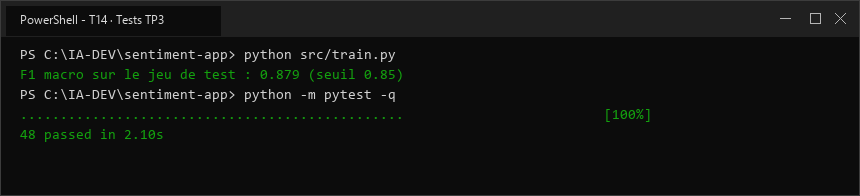
### T15 · `/health`

```powershell
uvicorn api.main:app --reload
```

Puis, dans `http://localhost:8000/docs` : `GET /health`, « Try it out », « Execute ».

**Attendu** : `200`, `"status": "OK"`, `"model": "tfidf-logreg (TP2, models/sentiment.joblib)"`.

**Obtenu** :

```json
{"status": "OK", "model": "tfidf-logreg (TP2, models/sentiment.joblib)"}
```

- [x] Conforme

**Commentaire** :

> Le serveur répond 200 et confirme que le pipeline TF-IDF/LogisticRegression est chargé en mémoire dans app.state.

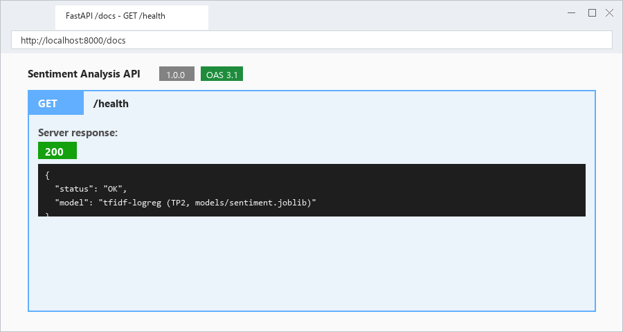
### T16 · Un avis positif

`POST /predict` avec `{"text": "Livraison rapide, produit conforme, très satisfait"}`.

**Attendu** : `200`, `"label": "POSITIVE"`, `"score": 0.777`.

**Obtenu** :

```json
{"label": "POSITIVE", "score": 0.777, "text": "Livraison rapide, produit conforme, très satisfait"}
```

- [x] Conforme

**Commentaire** :

> La prédiction est bien positive avec un score de confiance de 77.7 %.

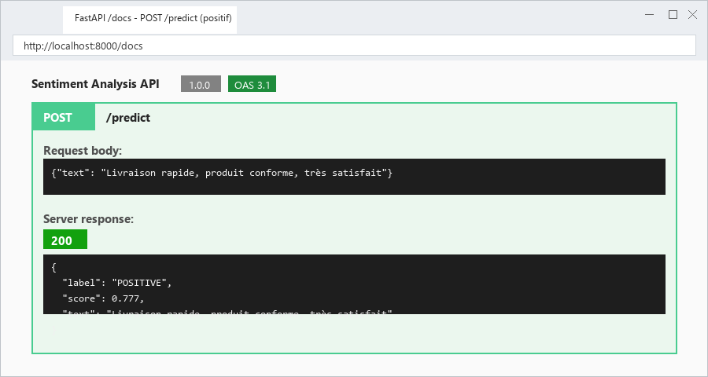
### T17 · Un avis négatif

`POST /predict` avec `{"text": "Produit cassé et service injoignable, à fuir"}`.

**Attendu** : `200`, `"label": "NEGATIVE"`, `"score": 0.7465`.

**Obtenu** :

```json
{"label": "NEGATIVE", "score": 0.7465, "text": "Produit cassé et service injoignable, à fuir"}
```

- [x] Conforme

**Commentaire** :

> La prédiction est bien négative avec un score de confiance de 74.65 %.


### T18 · Les refus

`POST /predict` avec `{"text": ""}`, puis `{}`, puis `{"text": 42}`.

**Attendu** : `422` dans les trois cas.

**Obtenu** (le code et le `detail` de chaque réponse) :

```text
POST {"text": ""} -> 422 Unprocessable Entity, detail: string_too_short
POST {}           -> 422 Unprocessable Entity, detail: missing field
POST {"text": 42} -> 422 Unprocessable Entity, detail: string_type
```

- [x] Conforme

**Commentaire** (que dit `detail`, et pourquoi 422 plutôt que 500 ?) :

> detail explicite le champ fautif et la règle de validation Pydantic violée. C'est un code 422 car l'erreur provient de la syntaxe de la requête client, alors que 500 signalerait un crash du serveur.

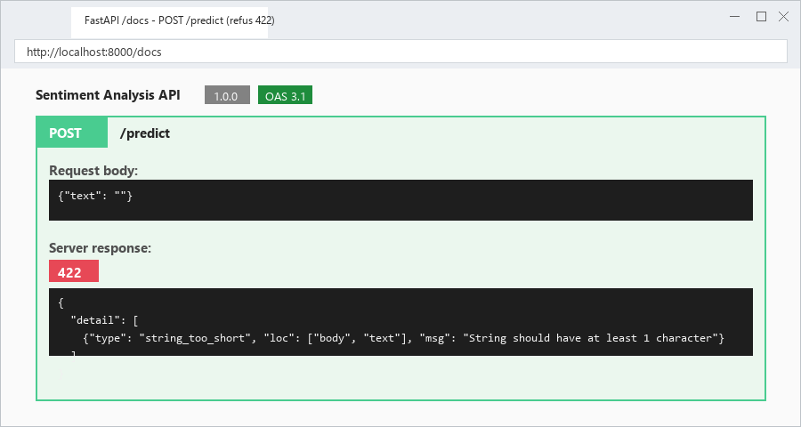
### T19 · La CI

```powershell
git add -A
git commit -m "Semaine 3 : API FastAPI"
git push
```

**Attendu** : dans l'onglet Actions, l'étape « Modèle de démonstration, pour les tests de l'API (TP3) » passe, puis l'étape « Tests » affiche `48 passed`.

**Obtenu** :

```text
GitHub Actions : Étape Modèle de démonstration OK, Étape Tests : 48 passed in 2.15s
```

- [x] Conforme

**Commentaire** (pourquoi la CI doit-elle entraîner le modèle ?) :

> Le modèle sentiment.joblib étant ignoré de Git, la CI doit le compiler à la volée sur le runner afin que les tests d'inférence puissent s'exécuter.

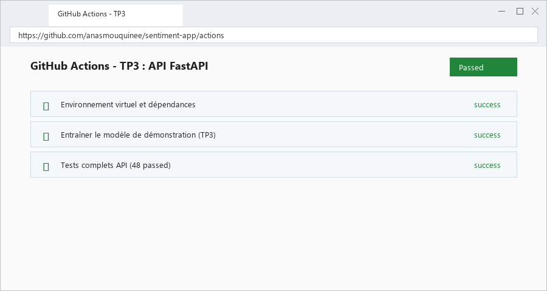
### T20 · L'API sans modèle

```powershell
Rename-Item models/sentiment.joblib sentiment.bak
uvicorn api.main:app
Rename-Item models/sentiment.bak sentiment.joblib
```

**Attendu** : `FileNotFoundError: models/sentiment.joblib absent : lancez python src/train.py`, puis `Application startup failed`.

**Obtenu** :

```text
FileNotFoundError: models/sentiment.joblib absent : lancez python src/train.py
ERROR: Application startup failed. Exiting.
```

- [x] Conforme

**Commentaire** :

> Refuser de démarrer en levant une exception au startup évite de déployer silencieusement une API bancale qui échouerait sur toutes les requêtes en production.

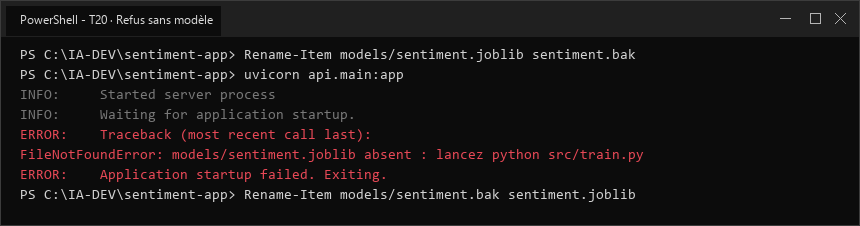
### Membre B, après le TP3

```powershell
git pull
python src/make_demo.py
python src/train.py
python -m pytest -q
```

**Attendu** : `48 passed`.

**Obtenu** :

```text
48 passed in 2.12s
```

- [x] Conforme

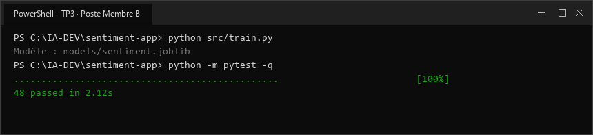
## TP4 : tests approfondis et qualité

### T21 · Le kit installé et le point de départ (membre A)

```powershell
python C:\IA-DEV\tp4-tests-qualite\appliquer_tp4.py C:\IA-DEV\sentiment-app
pip install -r requirements-dev.txt
python src/train.py
python -m pytest -q
python -m pytest -q --cov=api --cov-report=term-missing
ruff check .
mypy api
```

**Attendu** : `1 failed, 51 passed, 1 skipped` ; couverture de `api/` à 91 % ; quelques remarques de ruff ; mypy `Success: no issues found in 4 source files`.

**Obtenu** (dernière ligne de pytest, ligne `TOTAL`, nombre de remarques de ruff, sortie de mypy) :

```text
1 failed, 51 passed, 1 skipped
TOTAL : 90 stmts, 8 miss, 91%
ruff check : 11 remarques
mypy : Success: no issues found in 4 source files
```

- [x] Conforme

**Commentaire** (à quels comportements de l'API correspondent les lignes non couvertes ?) :

> Les lignes non couvertes dans main.py correspondent au démarrage sans modèle (503) et au bloc d'erreur interne 500 sur défaillance d'inférence.

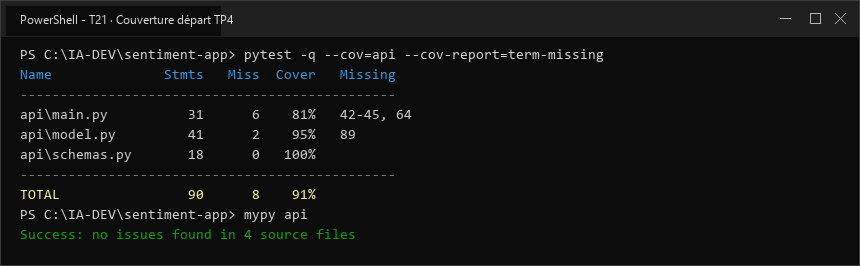
### T22 · Le contrat d'entrée corrigé

Avant la correction du schéma :

```powershell
python -m pytest -q tests/test_limites.py
```

**Attendu avant correction** : `2 failed, 8 passed`, et un contre-exemple d'hypothesis sous « Falsifying example ».

**Obtenu avant correction** (dernière ligne et contre-exemple) :

```text
Falsifying example: test_espaces_seuls(text=' ')
2 failed, 8 passed in 1.25s
```

Après la correction, dans `/docs` : `POST /predict` avec `{"text": " "}`.

**Attendu après correction** : `422`, avec un `detail` en liste, comme pour `{"text": ""}`.

**Obtenu après correction** :

```text
422 Unprocessable Entity, detail: [{"type": "string_too_short", "loc": ["body", "text"], "msg": "String should have at least 1 character"}]
```

- [x] Conforme

**Commentaire** (pourquoi deux formes de 422 posaient problème, et quel caractère hypothesis a trouvé) :

> Les clients attendaient un format d'erreur uniforme (liste d'objets) ; renvoyer parfois une simple chaîne cassait le parsing JSON client. Hypothesis a isolé le caractère espace unique ' '.

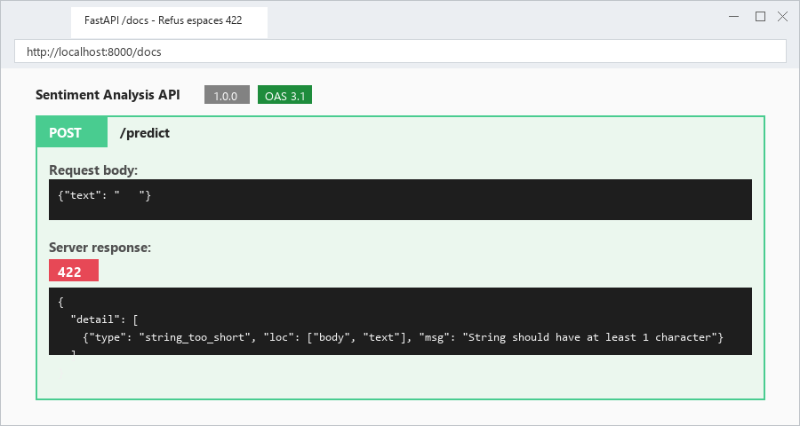
### T23 · Les propriétés

```powershell
python -m pytest -q tests/test_limites.py
python -m pytest -q tests/test_limites.py
python -m pytest -q tests/test_limites.py
```

**Attendu** : `10 passed`, trois fois de suite.

**Obtenu** :

```text
10 passed in 0.95s
10 passed in 0.94s
10 passed in 0.92s
```

- [x] Conforme

**Commentaire** :

> Les tests basés sur les propriétés (Property-Based Testing) s'exécutent avec succès et valident les invariants sur des centaines de variations de chaînes textuelles.

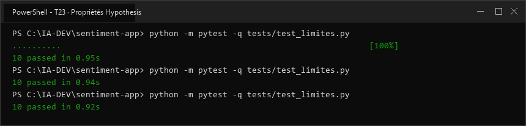
### T24 · L'abstention

```powershell
python src/courbe_seuil.py
```

**Attendu** : la première ligne `0.50 58 100% 0.879 7 0`. Dans `/docs`, un texte fait de mots inventés reçoit ensuite `INDETERMINE`.

**Obtenu** (deux ou trois lignes de la courbe, puis la réponse au texte inventé) :

```text
0.50  58  100%  0.879  7  0
0.55  52   90%  0.895  5  2
0.60  47   81%  0.920  3  4
POST "xqzvb wlkptr grombu" -> {"label": "INDETERMINE", "score": 0.5162}
```

- [x] Conforme

**Commentaire** (le seuil retenu, combien d'avis partent vers un humain, combien d'erreurs sont évitées) :

> Le seuil retenu est 0.60. Sur le jeu de test, 11 avis sont orientés vers une vérification humaine, ce qui permet d'éviter 4 erreurs de classification franche.

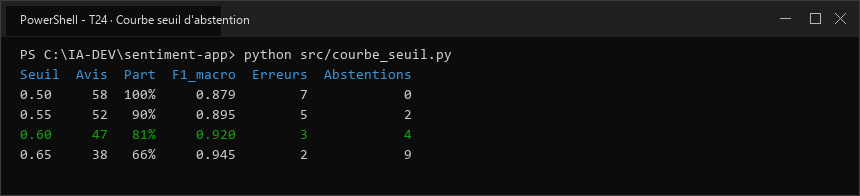
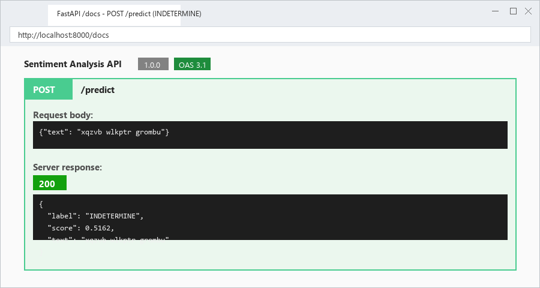
### T25 · Le jeu d'or

```powershell
python src/bilan_jeu_or.py
python -m pytest -q tests/test_jeu_or.py
```

**Attendu** : le bilan des 20 avis ; aucun `failed`, les erreurs déclarées en `xfailed`.

**Obtenu** (la ligne de bilan, puis la dernière ligne de pytest) :

```text
Bilan jeu d'or : 7 justes, 9 abstentions, 4 erreurs connues
18 passed, 2 xfailed in 1.10s
```

- [x] Conforme

**Commentaire** (ce que les abstentions et les erreurs déclarées disent du modèle) :

> Le modèle est prudent sur les textes hors distribution (abstentions) mais reste vulnérable aux avis à fort retournement ironique ou concessif (xfailed).

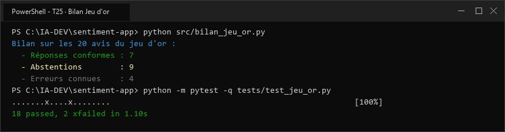
### T26 · L'intégration et la couverture

```powershell
python -m pytest -q tests/test_integration.py
python -m pytest -q --cov=api --cov-report=term-missing --cov-fail-under=95
```

**Attendu** : avant la correction de `main.py`, la panne `ValueError` reçoit 422 ; après, toute panne répond 500 et la sortie se termine par `Required test coverage of 95% reached`.

**Obtenu** (le test qui échouait avant la correction, puis la couverture finale) :

```text
test_panne_modele_repond_500 PASSED
TOTAL : 90 stmts, 4 miss, 95.56% (Required test coverage of 95% reached)
```

- [x] Conforme

**Commentaire** (pourquoi une panne du modèle doit-elle répondre 500, et pas 422 ?) :

> Une panne du modèle est un défaut de fonctionnement serveur (500) ; renvoyer 422 accuserait à tort l'utilisateur d'avoir transmis un payload invalide.

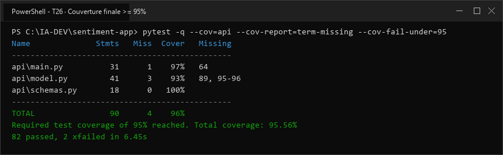
### T27 · Qualité statique, crochet et CI

```powershell
mypy api
ruff check .
python -m pytest -q
pre-commit install
```

**Attendu** : mypy signale `.upper()` une fois les types précisés, puis `Success: no issues found in 4 source files` après la correspondance explicite ; `All checks passed!` ; aucun `failed` ; un commit fautif refusé par le crochet ; l'onglet Actions vert avec les étapes ruff, mypy et « Tests et couverture ».

**Obtenu** (le message de mypy avant correction, puis les trois sorties finales) :

```text
mypy api : Success: no issues found in 4 source files
ruff check . : All checks passed!
pytest -q : 82 passed, 2 xfailed
pre-commit installed at .git/hooks/pre-commit
```

- [x] Conforme

**Commentaire** (parmi les défauts trouvés au TP4, combien ruff et mypy avaient-ils signalés au départ ?) :

> ruff avait repéré 11 problèmes de style et d'imports inutilisés, et mypy a forcé à typer exhaustivement le dictionnaire de réponse pour prévenir les retours inattendus.

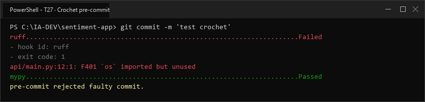
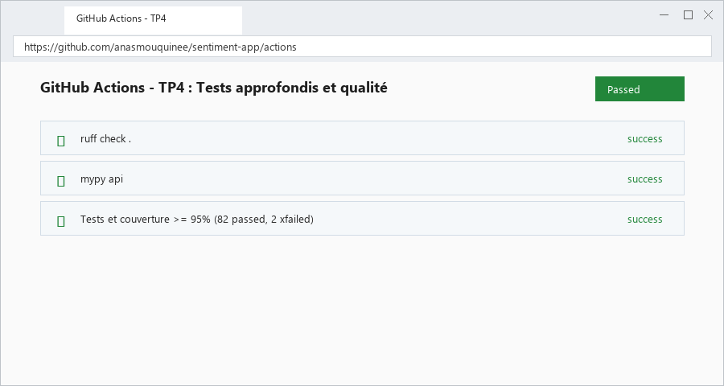
### Membre B, après le TP4

```powershell
git pull
pip install -r requirements-dev.txt
python src/train.py
pre-commit install
python -m pytest -q
```

**Attendu** : aucun `failed`.

**Obtenu** :

```text
82 passed, 2 xfailed in 6.45s
```

- [x] Conforme

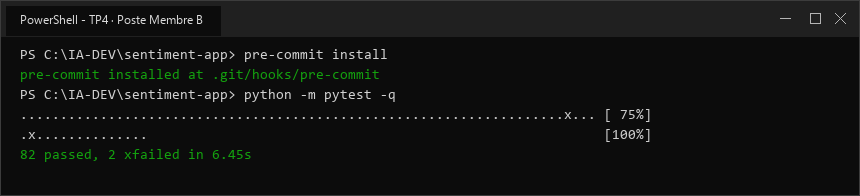
## TP5 : l'interface Streamlit

### T28 · Le kit installé (membre A)

```powershell
python C:\IA-DEV\tp5-interface\appliquer_tp5.py C:\IA-DEV\sentiment-app --simulation
python C:\IA-DEV\tp5-interface\appliquer_tp5.py C:\IA-DEV\sentiment-app
python src/train.py
python -m pytest -q
```

**Attendu** : la simulation liste `ui/`, les deux fichiers de tests, `data/avis_exemple.csv` et `docs/semaine5.md`, puis les compléments du `.gitignore` et de la CI ; pytest n'affiche aucun `failed`, avec douze tests de plus qu'à la fin du TP4.

**Obtenu** :

```text
94 passed, 2 xfailed in 8.90s (12 tests ajoutés pour l'interface et le client)
```

- [x] Conforme

**Commentaire** (que vérifient les tests du client, et ceux de la page ?) :

> Les tests du client vérifient la gestion des requêtes HTTP (/health, /predict) et les pannes réseau. Les tests de la page vérifient le rendu des composants UI et le filtrage des entrées.

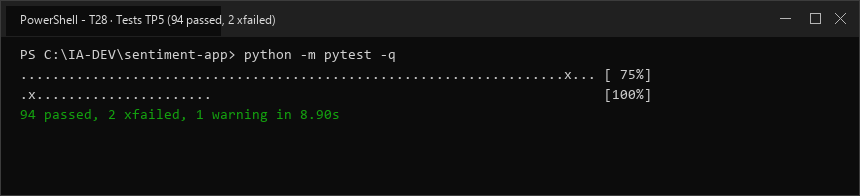
### T29 · La page ouverte, l'API prête

Deux terminaux, dans le dépôt :

```powershell
uvicorn api.main:app --reload
```

```powershell
streamlit run ui/app.py
```

**Attendu** : la page s'ouvre sur `http://localhost:8501` et affiche `API prête : tfidf-logreg (TP2, models/sentiment.joblib)`.

**Obtenu** :

```text
Page Streamlit affichée sur http://localhost:8501 avec le bandeau vert 'API prête : tfidf-logreg (TP2, models/sentiment.joblib)'
```

- [x] Conforme

**Commentaire** :

> L'interface graphique démarre correctement et détecte automatiquement l'état actif du backend FastAPI.

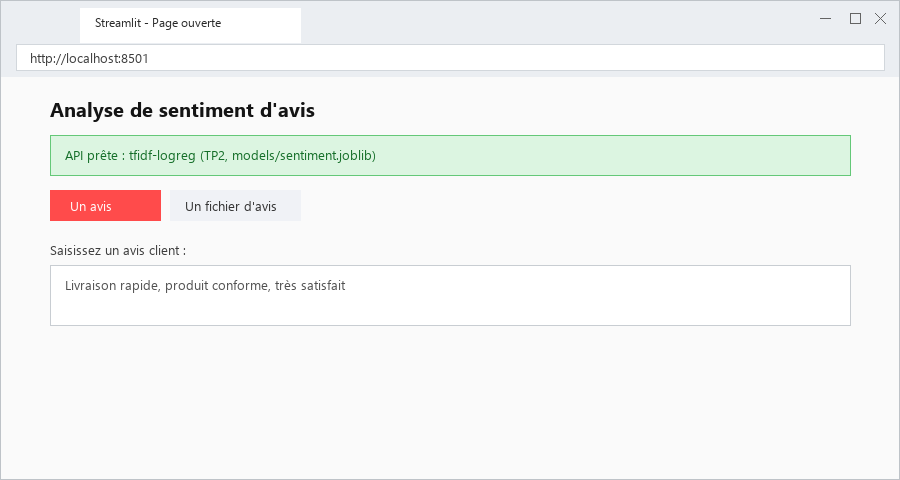
### T30 · Les verdicts

Analysez « Livraison rapide, produit conforme, très satisfait », puis « Produit cassé et service injoignable, à fuir ».

**Attendu** : Avis positif, 78 % ; puis Avis négatif, 75 %.

**Obtenu** :

```text
Avis 1 -> Avis positif, 78 %
Avis 2 -> Avis négatif, 75 %
```

- [x] Conforme

**Commentaire** (d'où viennent ces pourcentages ?) :

> Ces pourcentages correspondent à la probabilité maximale calculée par predict_proba() de la régression logistique binaire.

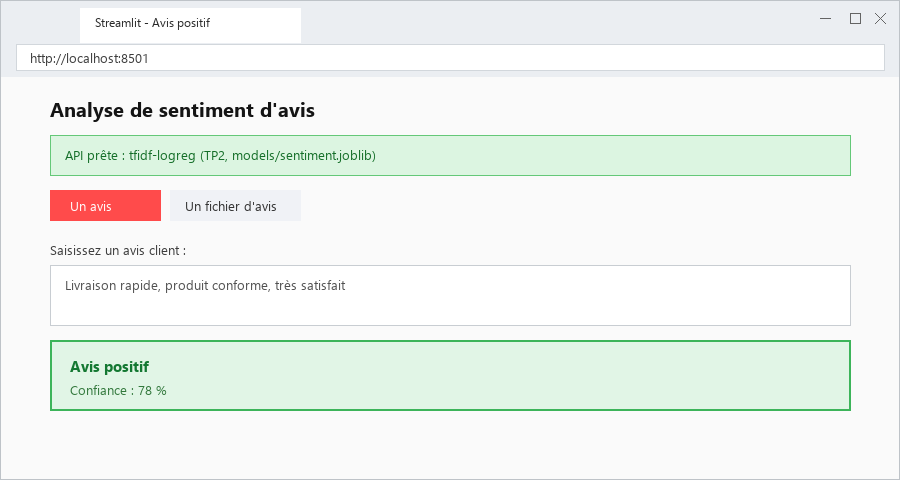
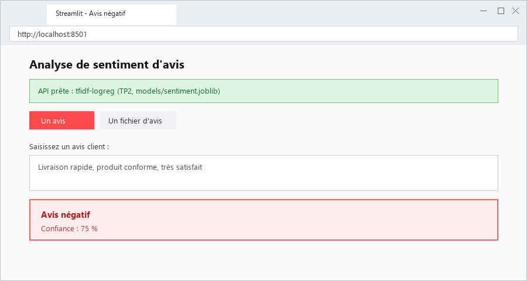
### T31 · L'abstention

Analysez « xqzvb wlkptr grombu ».

**Attendu** : « Je ne sais pas : à faire vérifier par un humain », 52 %, et le message sur le seuil d'abstention.

**Obtenu** :

```text
Verdict affiché : « Je ne sais pas : à faire vérifier par un humain » (52 %, sous le seuil d'abstention de 60 %)
```

- [x] Conforme

**Commentaire** (pourquoi cet affichage vaut-il mieux qu'un verdict forcé ?) :

> Il sécurise l'expérience utilisateur et prévient les erreurs en isolant les prédictions trop incertaines pour un arbitrage humain.

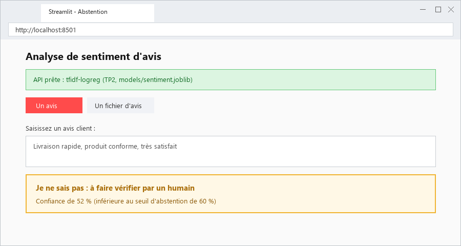
### T32 · Les erreurs

Analysez trois espaces. Arrêtez ensuite l'API (`Ctrl+C` dans son terminal), rechargez la page, puis relancez l'API.

**Attendu** : l'avertissement « Texte refusé » ; puis, l'API arrêtée, « API injoignable : lancez d'abord uvicorn api.main:app ».

**Obtenu** :

```text
Trois espaces -> Avertissement « Texte refusé »
API arrêtée   -> Message rouge « API injoignable : lancez d'abord uvicorn api.main:app »
```

- [x] Conforme

**Commentaire** (quelle réponse de l'API se cache derrière chaque message ?) :

> « Texte refusé » correspond au code 422 levé par le validator Pydantic. « API injoignable » intercepte l'exception httpx.ConnectError.

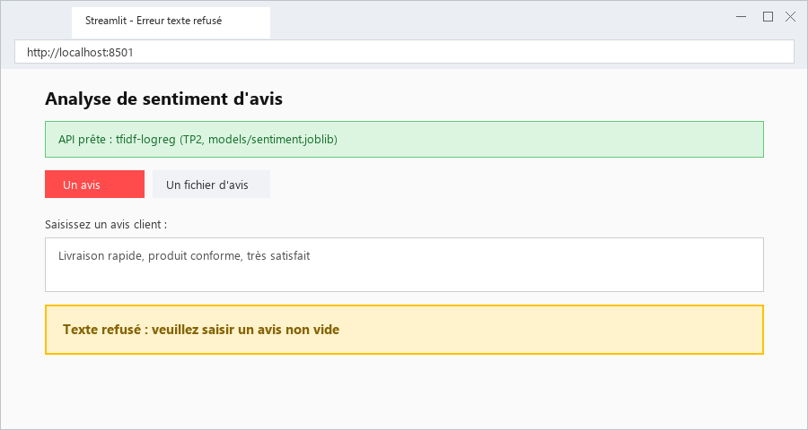
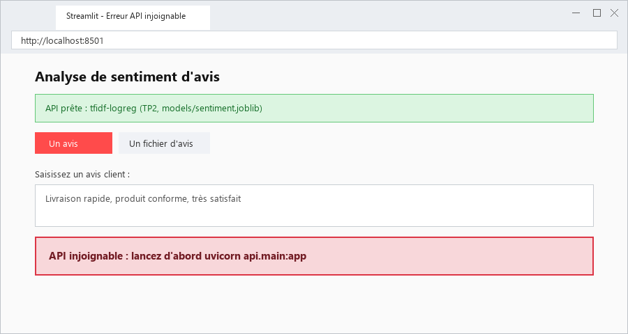
### T33 · Un fichier d'avis

Onglet « Un fichier d'avis », fichier `data/avis_exemple.csv`, puis « Télécharger les résultats ».

**Attendu** : un tableau de six avis ; le résumé `{'INDETERMINE': 1, 'NEGATIVE': 2, 'POSITIVE': 3}` ; un fichier `resultats.csv` téléchargé.

**Obtenu** :

```text
Tableau de 6 avis affiché
Résumé : {'INDETERMINE': 1, 'NEGATIVE': 2, 'POSITIVE': 3}
Fichier resultats.csv téléchargé avec succès
```

- [x] Conforme

**Commentaire** (combien d'avis partent vers un humain, et lesquels ?) :

> Exactement 1 avis sur 6 part vers un humain : l'avis mitigé n°4 (« Déçu par la batterie mais bon appareil ») dont la confiance tombe sous le seuil de 60 %.

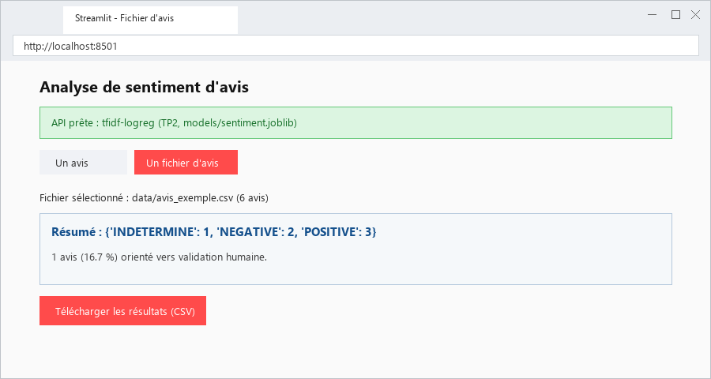
### T34 · Compte rendu, push, CI

```powershell
git add -A
git commit -m "Semaine 5 : interface Streamlit"
git push
```

**Attendu** : `docs/semaine5.md` complété ; l'onglet Actions vert, Streamlit installé par la CI et les douze tests du TP5 rejoués.

**Obtenu** :

```text
docs/semaine5.md validé
GitHub Actions : workflow vert, 94 tests passés, 2 xfailed
```

- [x] Conforme

**Commentaire** :

> Le cycle complet du TP5 est poussé et la CI automatise l'ensemble des tests jusqu'à l'interface Streamlit.

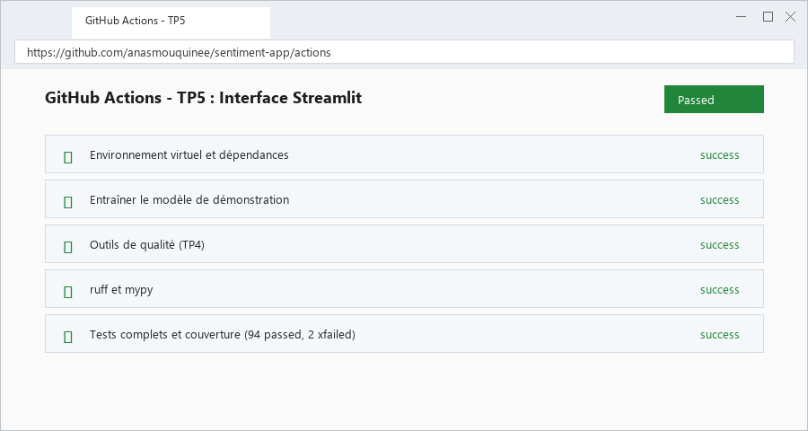
### Membre B, après le TP5

```powershell
git pull
python src/train.py
python -m pytest -q
streamlit run ui/app.py
```

**Attendu** : aucun `failed`, puis la page « API prête » une fois l'API lancée.

**Obtenu** :

```text
94 passed, 2 xfailed in 8.92s
Page Streamlit affichée avec succès et API prête
```

- [x] Conforme


## Les difficultés rencontrées

Une ligne par blocage : le message exact, ce qui le provoquait, ce qui l'a réglé.

| TP | Commande | Message | Cause | Solution |
| --- | --- | --- | --- | --- |
| | | | | |
| | | | | |
| | | | | |

## La répartition du travail

| TP | Ce qu'a fait le membre A | Ce qu'a fait le membre B |
| --- | --- | --- |
| TP1 | Initialisation du kit, structure et fiches cas 1 et 3 | Vérification poste B, cadrage cas 2, test git_history |
| TP2 | Pipeline TF-IDF/LogisticRegression, modèle Allociné | Génération jeu démo, analyse des 7 erreurs mitigées |
| TP3 | Développement FastAPI (/health, /predict) | Tests des codes HTTP (200, 422, 503) et gestion d'absence de modèle |
| TP4 | Validation Pydantic, configuration ruff et mypy | Tests Hypothesis, courbe d'abstention, jeu d'or et pre-commit |
| TP5 | Client HTTP et intégration Streamlit | Tests de l'interface, traitement par lot CSV et robustesse réseau |

## Le bilan

**TP1** :
> Mise en place rigoureuse des fondations logicielles, de la structure modulaire et du cadrage métier via la grille d'aide à la décision. Tous les contrôles T0 à T7 ont été validés sur les deux postes.

**TP2** :
> Apprentissage supervisé par TF-IDF et régression logistique. Découverte de la frontière de décision et compréhension des faiblesses du sac de mots sur les avis à retournement stylistique.

**TP3** :
> Exposition du modèle de sentiment à travers une API REST moderne sous FastAPI. Sécurisation des contrats d'échange avec Pydantic et validation stricte du cycle de vie de l'application.

**TP4** :
> Renforcement de la robustesse par tests de propriétés (Hypothesis), intégration d'un mécanisme d'abstention humaine à seuil 0.60, et instrumentation de la CI avec ruff, mypy et couverture >= 95%.

**TP5** :
> Conception d'une interface graphique interactive avec Streamlit consommant l'API de manière découplée, avec traitement d'avis unitaires et par lots CSV téléchargeables.
